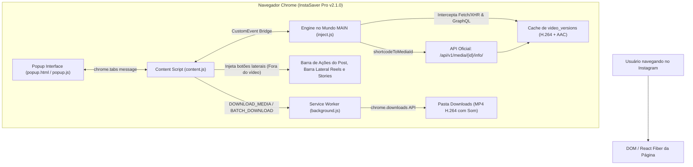

<div align="center">

  

  <br/><br/>

  <h1>📸 InstaSaver PRO (v2.1.0)</h1>
  <p><strong>A Extensão Definitiva para Baixar Vídeos, Reels, Stories, Destaques e Perfis Inteiros do Instagram com Áudio Estéreo e Compatibilidade Total (QuickTime, CapCut, Premiere, TikTok e YouTube Shorts).</strong></p>

  <p>
    <a href="#-instalação-rápida-30-segundos"></a>
    <a href="#-instalação-rápida-30-segundos"></a>
    <a href="LICENSE"></a>
    
    
    
  </p>

  <p>
    <a href="#-novidades-da-v210-botão-lateral-sem-pausar-o-vídeo">Novidades da v2.1.0</a> •
    <a href="#-o-diferencial-por-que-os-vídeos-abrem-perfeitamente-com-som">Qualidade H.264 + Som</a> •
    <a href="#-recursos-principais">Recursos</a> •
    <a href="#-como-instalar-no-chrome">Como Instalar</a> •
    <a href="#-download-em-lote-de-perfis-reels-em-massa">Download em Lote</a> •
    <a href="#-licença">Licença</a>
  </p>

</div>

---

## 🚀 Novidades da v2.1.0: Botão Lateral Nativo (Sem Pausar o Vídeo)

Nas versões anteriores com botão flutuante sobreposto em cima do vídeo, o clique do usuário frequentemente ativava o evento de pausar/reproduzir do player do Instagram. Na **v2.1.0**, o design foi completamente remodelado para garantir uma experiência suave e 100% funcional:

1. **Botão na Barra de Ações do Post (Feed, Modal e /p/):**
   - Inserido de forma nativa ao lado do botão de **Salvar / Bookmark** (`[ ⬇ Baixar ]`).
   - Fora do retângulo do vídeo: clique seguro que **nunca pausa nem interfere na reprodução**.
2. **Botão na Barra Lateral Vertical dos Reels:**
   - Inserido na coluna lateral direita dos Reels, empilhado com os ícones de Curtir, Comentar e Compartilhar.
   - Ícone circular estilizado com o rótulo **"Baixar"** logo abaixo.
3. **Resolução Algorítmica de Shortcode para Media ID:**
   - Novo algoritmo matemático em `inject.js` convertendo shortcodes de URL (ex: `Da872YJsgw9`) diretamente em IDs numéricos de 64 bits (`3944290595198078013`).
   - Consulta direta e autenticada ao endpoint oficial `/api/v1/media/${mediaId}/info/` da Meta e fallback para GraphQL.
   - Garantia de obtenção do arquivo progressivo **`video_versions[0].url`** (H.264 + áudio estéreo AAC multiplexado).

---

## 🎯 Por que os vídeos abrem perfeitamente com som?

### O Problema das Extensões Comuns:
No Google Chrome para computador, o player do Instagram transmite vídeos usando a tecnologia **DASH Adaptive Streaming**:
- **Trilha de Vídeo:** Transmitida separadamente em codec **VP9** (sem áudio).
- **Trilha de Áudio:** Transmitida separadamente em **M4A/AAC**.
- Se uma extensão apenas capturar o stream ativo do player, ela baixa o arquivo VP9 sem áudio. Ao tentar abrir no **QuickTime Player do Mac**, surge o erro:  
  *❌ "O documento não pôde ser aberto. O arquivo não é compatível com o QuickTime Player."*

### A Solução do InstaSaver Pro:
O **InstaSaver Pro** utiliza uma **engine in-page (`inject.js`)** que intercepta as respostas da API e do GraphQL da Meta e consulta a API oficial de mídia da Meta, capturando o campo original **`video_versions[0]`**:
- ✅ **Codec H.264 (AVC) Progressivo**: 1080p nítido, nativo de todos os sistemas operacionais.
- ✅ **Áudio Estéreo AAC Multiplexado**: Som limpo e calibrado diretamente dentro do mesmo arquivo `.mp4`.
- ✅ **Compatibilidade 100% Nativa**: Abre direto no **QuickTime**, **CapCut**, **Adobe Premiere**, **Final Cut Pro**, **WhatsApp**, **TikTok** e **YouTube Shorts** sem necessidade de conversão!

---

## ✨ Recursos Principais

| Recurso | Descrição |
| :--- | :--- |
| 🏷️ **Botão Lateral Nativo no Post** | Posicionado ao lado do botão de Salvar em todas as publicações. Clique em **`[ ⬇ Baixar ]`** para baixar o MP4 com som sem pausar o vídeo. |
| 🎬 **Botão na Barra Lateral de Reels** | Integrado à coluna vertical de ações no Reels (abaixo de Curtir, Comentar e Compartilhar). |
| 👥 **Download em Lote de Perfis** | Abra o perfil da empresa ou cliente e baixe os vídeos e Reels em fila com 1 clique para republicar no TikTok e YouTube. |
| ⭐ **Stories & Destaques** | Botão integrado no cabeçalho do player de Stories para baixar slides de vídeo ou fotos na resolução máxima. |
| 🖼️ **Botões na Grade do Perfil** | Passe o mouse sobre qualquer miniatura na grade de publicações e clique no ícone de download direto, sem precisar abrir o post. |
| 🔗 **Aba Colar Link** | Cole o link de qualquer publicação pública (`/reel/...` ou `/p/...`) diretamente no popup para baixar o MP4 original. |
| 🛡️ **Zero Anúncios & 100% Privado** | Sem rastreadores, sem envio de cookies ou dados externos. Todo o processamento ocorre localmente no navegador. |

---

## 🛠️ Como Funciona a Arquitetura (v2.1.0)



---

## 📥 Como Instalar / Atualizar no Chrome

1. No Google Chrome, digite na barra de endereços:
   ```text
   chrome://extensions
   ```
2. No canto superior direito, certifique-se de que o **"Modo do desenvolvedor"** (*Developer mode*) está ativado.
3. Se você já tem a extensão adicionada:
   - Basta clicar no ícone de **Atualizar 🔄** no card do **InstaSaver Pro**.
4. Se for a primeira instalação:
   - Clique em **"Carregar sem compactação"** (*Load unpacked*) no canto superior esquerdo.
   - Selecione a pasta do projeto:
     ```text
     /Users/danieljuniorbarbosadasilva/Desktop/01 - Projetos & Sistemas/InstaSaver-Pro
     ```
5. No ícone de quebra-cabeça do Chrome, fixe o **InstaSaver Pro** clicando no alfinete 📌.
6. Atualize a aba do Instagram (`F5` ou `Cmd + R`) e você verá o botão **`[ ⬇ Baixar ]`** ao lado do botão de Salvar no post, ou na barra lateral direita nos Reels!

---

## 👥 Download em Lote de Perfis (Reels em Massa)

Para baixar vários vídeos do perfil do cliente e republicá-los:

1. Abra o perfil desejado no Instagram (ex: `https://www.instagram.com/nomedocliente/reels/`).
2. Clique no ícone do **InstaSaver Pro** na barra de ferramentas do Chrome.
3. Acesse a aba **"Perfil em Lote"**.
4. Clique em **"🔄 Rolar Página"** para carregar mais publicações se desejar.
5. Clique em **"⬇ Baixar Todos os Vídeos Detectados"**.
6. A extensão baixa os arquivos sequencialmente em MP4 de alta qualidade prontos para subir no CapCut, YouTube Shorts e TikTok.

---

## 📄 Licença

Distribuído sob a licença MIT. Consulte o arquivo [LICENSE](LICENSE) para obter mais informações. Desenvolvido para máxima produtividade pela **DL Mídia**.
