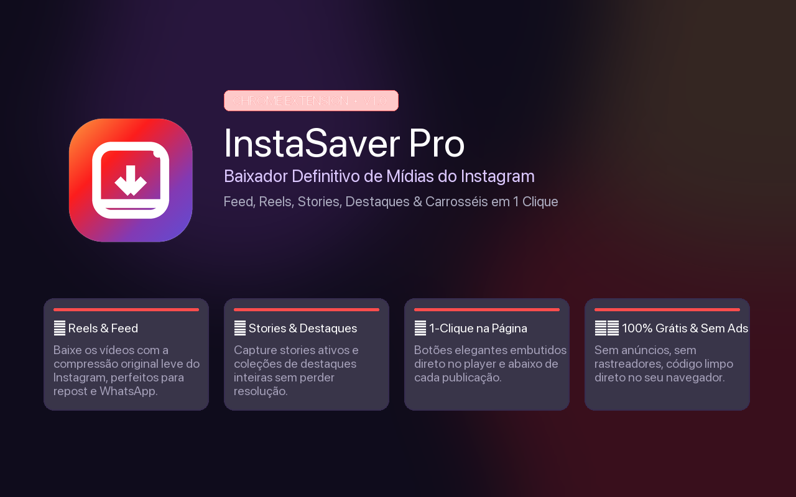
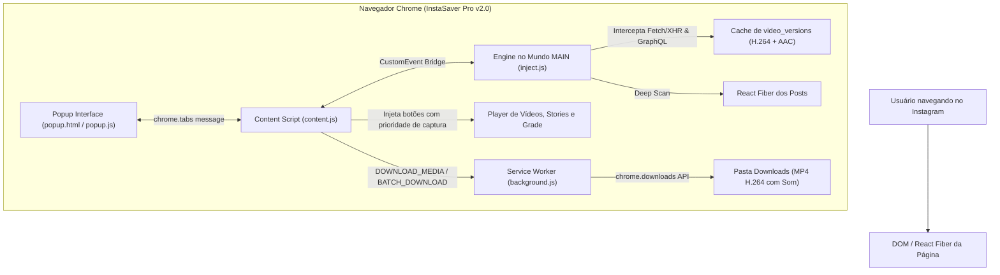

<div align="center">

  

  <br/><br/>

  <h1>📸 InstaSaver PRO (v2.0)</h1>
  <p><strong>A Extensão Definitiva para Baixar Vídeos, Reels, Stories, Destaques e Perfis Inteiros do Instagram com Áudio Estéreo e Compatibilidade Total (QuickTime, CapCut, Premiere, TikTok e YouTube Shorts).</strong></p>

  <p>
    <a href="#-instalação-rápida-30-segundos"></a>
    <a href="#-instalação-rápida-30-segundos"></a>
    <a href="LICENSE"></a>
    
    
    
  </p>

  <p>
    <a href="#-o-diferencial-da-v20-por-que-os-vídeos-agora-abrem-perfeitamente">O Diferencial da v2.0</a> •
    <a href="#-recursos-principais">Recursos</a> •
    <a href="#-como-funciona-a-arquitetura">Arquitetura</a> •
    <a href="#-como-instalar-no-chrome">Como Instalar</a> •
    <a href="#-download-em-lote-de-perfis-reels-em-massa">Download em Lote</a> •
    <a href="#-licença">Licença</a>
  </p>

</div>

---

## 🎯 O Diferencial da v2.0: Por que os vídeos agora abrem perfeitamente com som?

### O Problema das Extensões Comuns:
No Google Chrome para computador, o player do Instagram transmite vídeos usando a tecnologia **DASH Adaptive Streaming**:
- **Trilha de Vídeo:** Transmitida separadamente em codec **VP9** (sem faixa de áudio).
- **Trilha de Áudio:** Transmitida separadamente em **M4A/AAC**.
- Se uma extensão apenas "farejar" o stream do player, ela baixa o arquivo VP9 sem áudio. Quando você tenta abrir no **QuickTime Player do Mac**, surge o erro:  
  *❌ "O documento não pôde ser aberto. O arquivo não é compatível com o QuickTime Player."*

### A Solução Implementada no InstaSaver Pro v2.0:
O **InstaSaver Pro v2.0** não depende do stream fragmentado do player. Ele utiliza uma **engine in-page (`inject.js`)** que intercepta as respostas da API e do GraphQL da Meta, capturando o campo oficial **`video_versions[0]`**:
- ✅ **Codec H.264 (AVC) Progressivo**: 1080p nítido, nativo de todos os sistemas operacionais.
- ✅ **Áudio Estéreo AAC Multiplexado**: Som limpo e calibrado diretamente dentro do mesmo arquivo `.mp4`.
- ✅ **Compatibilidade 100% Nativa**: Abre direto no **QuickTime**, **CapCut**, **Adobe Premiere**, **Final Cut Pro**, **WhatsApp**, **TikTok** e **YouTube Shorts** sem necessidade de conversão!

---

## ✨ Recursos Principais

| Recurso | Descrição |
| :--- | :--- |
| 🎬 **Botão Flutuante em Cada Vídeo** | Passe o mouse em cima de qualquer Reels ou post do Feed e clique em **`[ ⬇ Baixar Vídeo (MP4) ]`**. Baixa apenas aquele vídeo específico instantaneamente. |
| 👥 **Download em Lote de Perfis** | Abra o perfil da empresa ou cliente e baixe os vídeos e Reels em fila com 1 clique para republicar no TikTok e YouTube. |
| ⭐ **Stories & Destaques** | Botão integrado no cabeçalho do player de Stories para baixar slides de vídeo ou fotos na resolução máxima. |
| 🖼️ **Botões na Grade do Perfil** | Passe o mouse sobre qualquer miniatura na grade de publicações e clique no ícone de download direto, sem precisar abrir o post. |
| 🔗 **Aba Colar Link** | Cole o link de qualquer publicação pública (`/reel/...` ou `/p/...`) diretamente no popup para baixar o MP4 original. |
| 🛡️ **Zero Anúncios & 100% Privado** | Sem rastreadores, sem envio de cookies ou dados externos. Todo o processamento ocorre no navegador do usuário. |

---

## 🛠️ Como Funciona a Arquitetura (v2.0)



---

## 📥 Como Instalar no Chrome (Passo a Passo)

1. No Google Chrome, digite na barra de endereços:
   ```text
   chrome://extensions
   ```
2. No canto superior direito, ative a chave **"Modo do desenvolvedor"** (*Developer mode*).
3. Clique em **"Carregar sem compactação"** (*Load unpacked*) no canto superior esquerdo.
4. Selecione a pasta do projeto:
   ```text
   InstaSaver-Pro
   ```
5. No ícone de quebra-cabeça do Chrome, clique no alfinete 📌 ao lado de **InstaSaver Pro** para fixá-lo.

> Se você já tinha a versão anterior instalada, basta abrir `chrome://extensions` e clicar no ícone de **Atualizar 🔄** no card do InstaSaver Pro.

---

## 👥 Download em Lote de Perfis (Reels em Massa)

Para baixar todos os vídeos de um perfil ou cliente para replicar em outras redes:
1. Abra o perfil desejado no Instagram (ex: `instagram.com/nome_do_cliente/reels/`).
2. Clique no ícone do **InstaSaver Pro** na barra do navegador.
3. Vá para a aba **"Perfil em Lote"**.
4. Clique em **"🔄 Rolar Página (Carregar Mais Vídeos)"** para que o Instagram carregue os posts na memória.
5. Clique em **"⬇ Baixar Todos os Vídeos Detectados"**. A extensão baixará todos os arquivos sequencialmente em MP4 com nomes organizados: `insta_cliente_codigo.mp4`.

---

## 📂 Estrutura de Arquivos

```text
InstaSaver-Pro/
├── manifest.json            # Manifesto Manifest V3 atualizado
├── inject.js                # Engine no mundo MAIN (intercepta video_versions H.264)
├── background.js            # Gerenciador de downloads sequenciais e lote
├── content.js               # Injeção de botões flutuantes, stories e grade
├── content.css              # Estilos elegantes e tema escuro
├── popup.html               # Interface do popup com abas e preview
├── popup.js                 # Controlador do popup e download em lote
├── popup.css                # Estilo moderno com gradiente do Instagram
├── icons/                   # Ícones oficiais (16, 32, 48 e 128px)
├── dist/                    # Pacotes compilados (.zip e .crx) para a Chrome Web Store
├── COMO_INSTALAR.md         # Guia rápido de instalação
├── PRIVACY_POLICY.md        # Política de privacidade oficial
├── LICENSE                  # Licença MIT
└── README.md                # Documentação completa
```

---

## 📄 Licença

Distribuído sob a licença **MIT**. Veja o arquivo [`LICENSE`](LICENSE) para mais detalhes.

<div align="center">
  <sub>Desenvolvido com excelência por <strong>DL Mídia</strong>.</sub>
</div>
