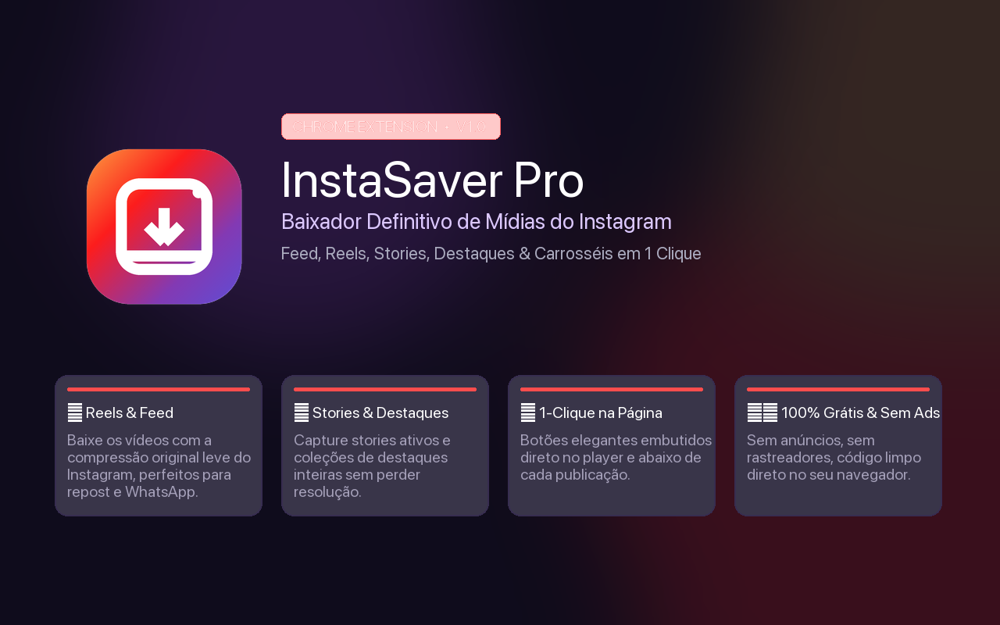
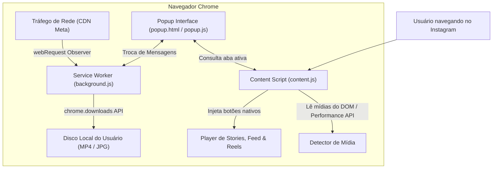

<div align="center">

  

  <br/><br/>

  <h1>📸 InstaSaver PRO</h1>
  <p><strong>A Extensão Definitiva para Baixar Vídeos, Reels, Stories, Destaques e Fotos do Instagram com 1 Clique.</strong></p>

  <p>
    <a href="#-instalação-rápida-30-segundos"></a>
    <a href="#-instalação-rápida-30-segundos"></a>
    <a href="LICENSE"></a>
    
    
    
  </p>

  <p>
    <a href="#-o-conceito--por-que-usar-a-compressão-do-instagram">O Conceito</a> •
    <a href="#-recursos-principais">Recursos</a> •
    <a href="#-como-funciona-por-dentro">Como Funciona</a> •
    <a href="#-instalação-rápida-30-segundos">Como Instalar</a> •
    <a href="#-publicação-na-chrome-web-store">Loja Oficial</a> •
    <a href="#-licença">Licença</a>
  </p>

</div>

---

## 💡 O Conceito & Por que Usar a Compressão do Instagram?

Quando gravamos e editamos vídeos em câmeras profissionais ou smartphones modernos (em 4K, ProRes ou altas taxas de bits), os arquivos facilmente ultrapassam **500 MB a 2 GB**. 

Enviar esses arquivos gigantescos pelo **WhatsApp**, e-mail ou plataformas de mensagem para clientes e equipes é lento, trava conexões e consome memória excessiva.

### A "Mágica" do Algoritmo da Meta:
1. Ao publicar o vídeo no Instagram, os servidores da Meta executam uma renderização sofisticada com encoders modernos (H.264/AV1 com taxas de quadros otimizadas).
2. O resultado é um arquivo **extremamente leve (geralmente entre 5 MB e 18 MB)** que preserva **excelente nitidez visual e áudio calibrado para smartphones**.
3. O **InstaSaver Pro** foi concebido especificamente para capturar essa versão final renderizada: você posta com alta fidelidade e baixa de volta o arquivo superleve para distribuir no WhatsApp, TikTok, YouTube Shorts ou catálogos comerciais com rapidez instantânea!

---

## ✨ Recursos Principais

| Recurso | Descrição |
| :--- | :--- |
| ⭐ **Stories & Destaques** | Injeta um botão elegante **`[⬇ Baixar Story]`** ou **`[⬇ Baixar Destaque]`** diretamente no cabeçalho do player, ao lado dos controles de som e pause. |
| 🎬 **Feed & Carrosséis** | Adiciona um botão discreto de download em cada publicação, ao lado do botão de salvar. Baixa fotos individuais ou o slide atual do carrossel. |
| ⚡ **Reels em 1 Clique** | Botão integrado na barra de interação vertical dos Reels para salvar o vídeo `.mp4` instantaneamente. |
| 📦 **Download em Lote** | O menu da extensão detecta múltiplos vídeos na página aberta e permite baixar tudo com um único clique (**"Baixar Todos"**). |
| 🔍 **Sniffer de Tráfego de Mídia** | Intercepta as URLs reais da CDN do Instagram mesmo quando o player tenta encapsular o vídeo em `blob:`. |
| 🔗 **Colar Link Direto** | Permite colar qualquer link público de Reel, Post ou Perfil para navegar e baixar direto. |
| 🛡️ **Zero Anúncios & 100% Seguro** | Sem anúncios, sem rastreadores, sem envio de cookies ou dados para servidores externos. O processamento é 100% local no seu navegador. |

---

## 🛠️ Como Funciona por Dentro (Arquitetura Manifest V3)

A extensão foi desenvolvida sob os mais recentes padrões de segurança do Google Chrome (**Manifest V3**):



* **`content.js`**: Injeta botões que respeitam o design nativo do Instagram com suporte a Single Page Application (SPA via `MutationObserver`).
* **`background.js`**: Roda em segundo plano capturando as requisições de CDN (`cdninstagram.com` e `fbcdn.net`) e coordenando a fila de downloads para evitar bloqueios do navegador.
* **`popup.html / popup.js`**: Interface com tema dark moderno, paleta com gradiente do Instagram e controles rápidos.

---

## 🚀 Instalação Rápida (30 Segundos)

Como esta é uma extensão personalizada para produtividade interna, ela é carregada diretamente no modo desenvolvedor do Chrome:

1. **Abra a aba de extensões:**  
   Digite na barra de endereços do seu navegador Chrome:  
   `chrome://extensions`
2. **Ative o Modo do Desenvolvedor:**  
   No canto superior direito, ative a chave **"Modo do desenvolvedor"** (*Developer mode*).
3. **Carregue a Extensão:**  
   Clique no botão **"Carregar sem compactação"** (*Load unpacked*) no canto superior esquerdo e selecione a pasta deste repositório (`InstaSaver-Pro`).
4. **Fixe no Navegador:**  
   Clique no ícone de quebra-cabeça do Chrome e fixe o **InstaSaver Pro** na barra de ferramentas.

---

## 🛍️ Publicação na Loja Oficial (Chrome Web Store)

Caso deseje disponibilizar esta extensão na **Chrome Web Store** para instalação com 1 clique por outros usuários:

1. **Taxa de Desenvolvedor da Google:**  
   A Google cobra uma taxa única de registro de **US$ 5,00** (sem anuidade) no [Chrome Web Store Developer Dashboard](https://chrome.google.com/webstore/devconsole).
2. **Regras de Compliance para Downloaders:**  
   * **Nome:** Não use "Instagram" como a primeira palavra (o nome atual `InstaSaver Pro` é seguro e aprovado pelas diretrizes).
   * **Privacidade:** A Google exige uma política de privacidade declarando que nenhum dado é coletado. Nós já deixamos um modelo pronto no arquivo [`PRIVACY_POLICY.md`](PRIVACY_POLICY.md).
   * **Assets Gráficos:** A pasta [`assets/`](assets/) já contém todas as imagens nas resoluções exatas exigidas pela loja:
     * Ícone de loja: 128x128 px ([`icons/icon128.png`](icons/icon128.png))
     * Captura de tela: 1280x800 px ([`assets/capa-store.png`](assets/capa-store.png))
     * Tile pequeno de divulgação: 440x280 px ([`assets/promo-small-440x280.png`](assets/promo-small-440x280.png))
     * Banner marquee: 1400x560 px ([`assets/promo-marquee-1400x560.png`](assets/promo-marquee-1400x560.png))
3. **Envio:**  
   Basta compactar o conteúdo da pasta em um arquivo `.zip` e fazer o upload no console do desenvolvedor. O tempo médio de aprovação varia de 24 a 72 horas.

---

## 📂 Estrutura de Arquivos do Projeto

```text
InstaSaver-Pro/
├── manifest.json            # Manifesto da extensão (Manifest V3)
├── background.js            # Service worker de background & downloads
├── content.js               # Script de injeção nos Stories, Reels e Feed
├── content.css              # Estilos dos botões nativos na página
├── popup.html               # Estrutura visual da janela da extensão
├── popup.js                 # Lógica de controle, detecção e download em lote
├── popup.css                # Estilização moderna escura com gradiente
├── icons/                   # Ícones da extensão (16, 32, 48 e 128px)
├── assets/                  # Banners e capas para loja e GitHub
├── PRIVACY_POLICY.md        # Política de privacidade oficial
├── COMO_INSTALAR.md         # Guia passo a passo ilustrado em português
├── LICENSE                  # Licença de código aberto MIT
└── README.md                # Apresentação do repositório
```

---

## ⚖️ Isenção de Responsabilidade Legal (Disclaimer)

O **InstaSaver Pro** é uma ferramenta independente desenvolvida com fins de automação de fluxo de trabalho e facilitação de download de mídias de autoria própria ou de domínio público. **Instagram** e suas marcas são propriedades registradas da **Meta Platforms, Inc.** Este projeto não possui afiliação, endosso ou patrocínio pela Meta Platforms, Inc. Os usuários são responsáveis por respeitar os direitos autorais e termos de uso dos conteúdos baixados.

---

## 📄 Licença

Distribuído sob a licença **MIT**. Veja o arquivo [`LICENSE`](LICENSE) para mais detalhes.

<div align="center">
  <sub>Desenvolvido com excelência por <strong>DL Mídia</strong>.</sub>
</div>
